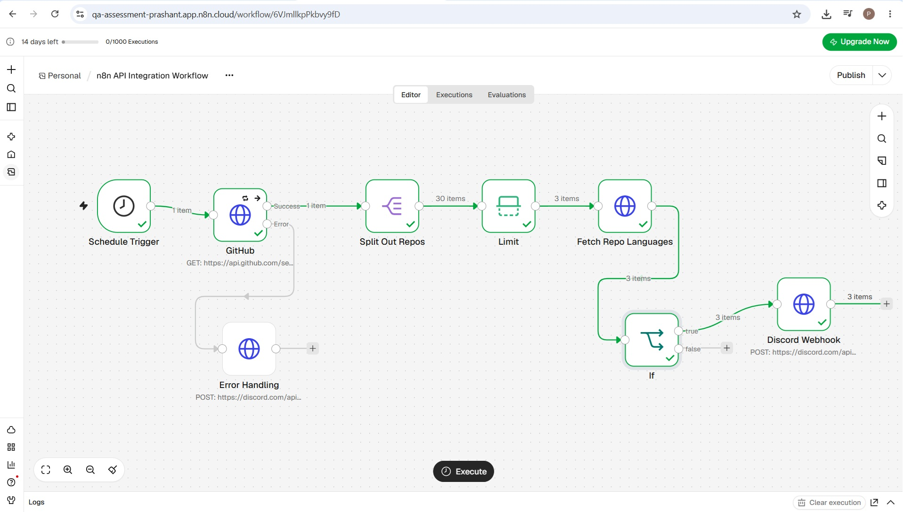
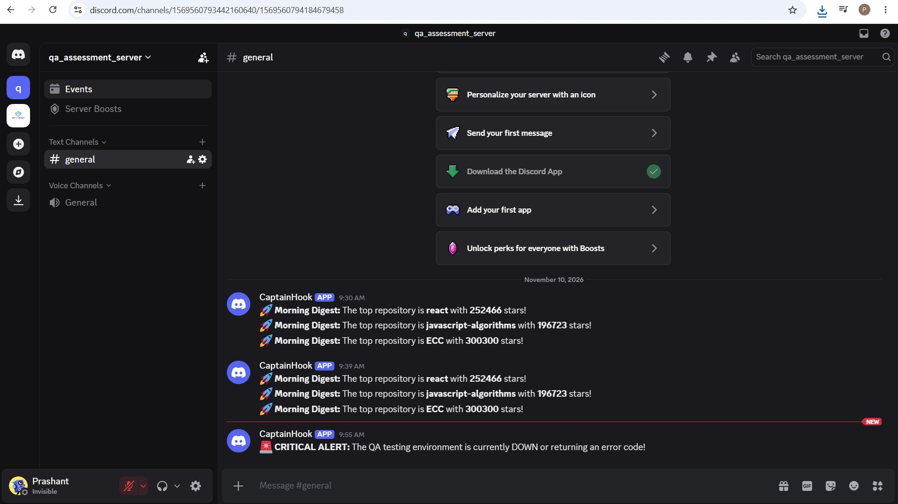
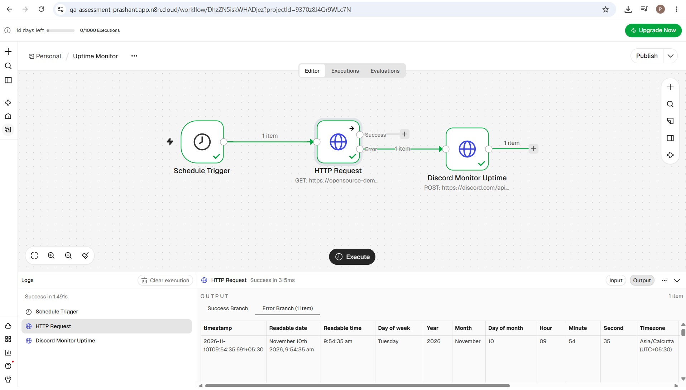

# Automation & QA Developer Assessment

**Candidate:** Prashant  
**Loom Video Walkthrough:** https://drive.google.com/file/d/1_Mvv3auNW6lL63VzZLRCZQsBYcA9LczZ/view?usp=drive_link

## Files Included in this Repository
* `Task1_QA_Report_Candidate.pdf`: The bug report and root cause analysis.
* `Task2_Workflow_Prashant.json`: The main n8n GitHub data workflow.
* `Bonus_UptimeMonitor_Prashant.json`: The n8n uptime monitor workflow.
* `Screenshots`: Visual proof of the n8n canvas layouts and successful Discord executions.

---

## Task 1: QA Testing Environment
The originally suggested `demo.realworld.io` testing environment was returning a 404 (NoSuchBucket) error at the time of testing. As permitted by the instructions to use any open-source SaaS app, I pivoted and performed my QA bug hunt on the OrangeHRM Open Source Demo environment. The findings, including a critical HTML injection vulnerability, are documented in the attached QA Report.

## Task 2: n8n Workflow Logic ("GitHub Morning Brief")

**1. APIs Used & Why:**
I built a "Morning Digest" workflow that notifies the team of the top trending tools on GitHub. 
*   **API 1 (Data Fetch):** GitHub REST API (`/search/repositories`). I used this to fetch the most popular JavaScript repositories. 
*   **API 2 (Enrichment):** GitHub REST API (`/languages`). I used the `languages_url` endpoint provided by the first API to fetch the specific byte-count of programming languages used in the top repositories.

**2. Data Transformation:**
The initial GitHub search returns a heavily nested JSON payload with 30 items. To transform this for the digest, I utilized a **Split Out** node to separate the `items` array into individual manageable objects, followed immediately by an **Item Lists** node set to `Limit: 3`. This cleanly isolated only the top repositories, preventing unnecessary API calls and preventing API rate limits. I also authenticated both HTTP requests using GitHub API credentials from the n8n credentials store.

*(Below: The main workflow canvas including the Error Handling branch)*

*(Below: Successful Discord Digest Output)*

**3. Conditional Routing:**
I implemented an **If** node with a threshold condition targeting the `stargazers_count`. Repositories with greater than 1,000 stars were routed to the True path to be published to the Discord webhook.

**4. Error Handling:**
To ensure the workflow does not crash silently during API outages or rate limits (403 errors), I configured the primary HTTP Request node's "On Error" behavior to `Continue (using error output)`. This dedicated error branch is routed to a fallback Webhook that sends an alert to the notification channel (e.g., "Morning Brief Failed: GitHub API unreachable"), ensuring the team is immediately aware of silent failures.

## Bonus Task: Uptime Monitor
I also built an automated Uptime Monitor for the OrangeHRM QA environment. 
*   **Trigger:** A Schedule Trigger runs every 5 minutes.
*   **Logic:** An HTTP Request node performs a GET request to the OrangeHRM URL. 
*   **Error Routing:** I configured the node's settings to output errors to the workflow rather than halting. If the site returns a non-200 status code (down or unreachable), the error branch triggers a POST request to the Discord webhook, sending a critical downtime alert to the team.

*(Below: Successful Uptime Monitor Output)*
